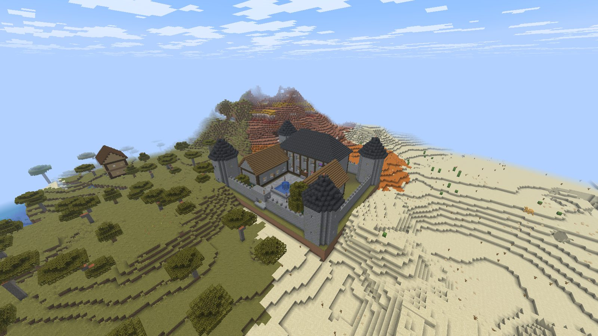
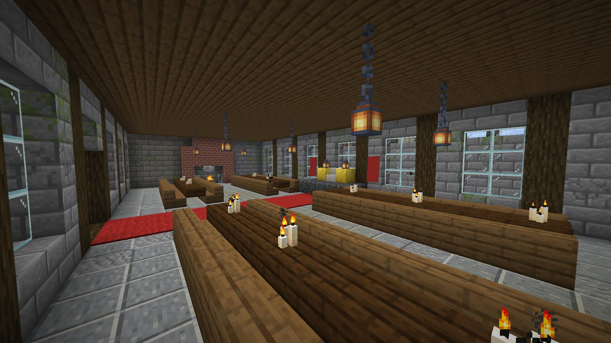
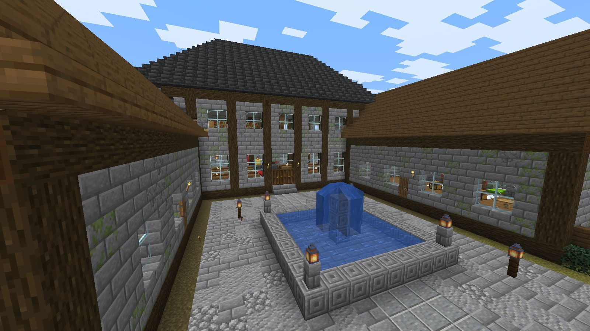
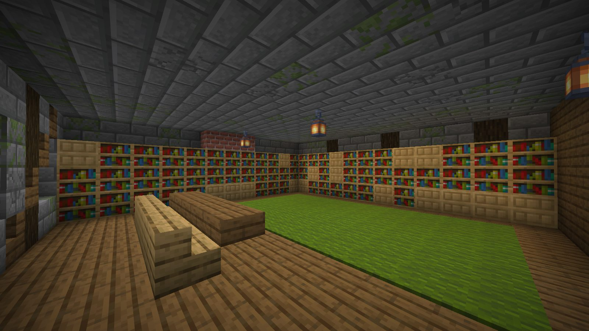
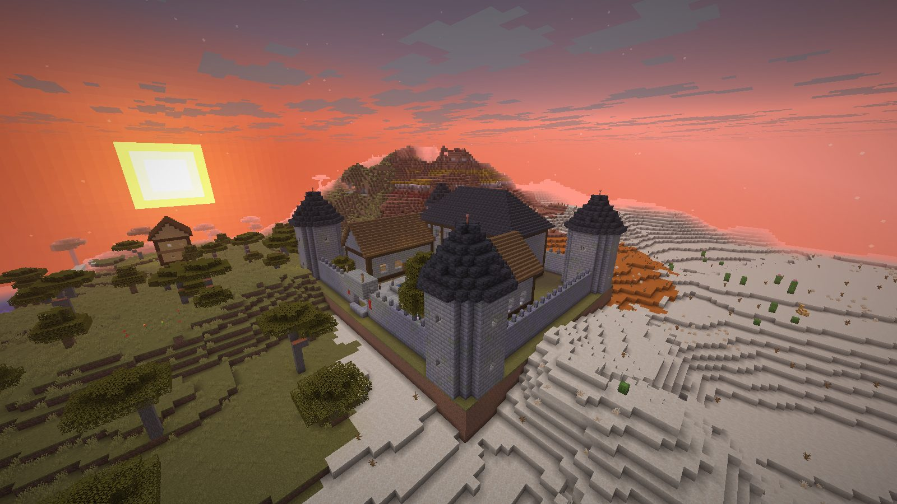

# minecraft-mcp

An MCP server that lets Claude build **whole structures** in Minecraft Java 26.3: a furnished, walled manor
of 100k planned blocks goes from one script to the world in about 5 seconds, and comes back out with one undo.



| | |
|---|---|
|  |  |
|  |  |

## How it works

```
Claude ──MCP(stdio)──> mcmcp.server ──RCON──> vanilla 26.3 server (localhost, creative)
                            │                       ▲
                            ├─ build script ─> Canvas (planned blocks, rotation-aware)
                            ├─ compile ──────> structure template .nbt ─ one `/place template`
                            ├─ snapshot ─────> undo template (read from region files first)
                            └─ read/render <── Anvil region files (+ client-jar textures)
```

* **Plan, then place once.** A build is a short Python script against a builder API (rooms, walls, gable/hip
  roofs, stairs, doors, windows, beds, chairs, tables, kitchens, chests with items, lamps, signs, domes,
  cylinders...). Modules are written once and stamped anywhere at any rotation with `b.at(x, y, z, rot)`.
  The whole canvas becomes one structure template placed by a single command, so size is not limited by
  `/fill`'s 32,768-block cap or by RCON round trips.
* **Undo for everything.** Before placing, the engine force-loads the area, flushes the save and reads the
  existing blocks (including chest contents) from the region files into an undo template.
* **Eyes.** `render`/`render_build` draw an isometric PNG with the real block models and textures from the
  client jar (cutaways show each floor's interior); `scan_region`, `surface_map`, `find_build_site` and
  `get_block` read the save directly.
* **Validation.** Block ids and properties are checked against the 26.3 data reports, with suggestions
  ("unknown block 'oak_stair'; did you mean minecraft:oak_stairs?").

## Tools

| Tool | What it does |
|---|---|
| `server_status`, `start_server`, `stop_server`, `server_log` | Lifecycle of the bundled server |
| `build(script, x, y, z, rotation, dry_run)` | Run a build script and place the result (API in the tool description) |
| `undo`, `list_builds` | History with exact restore |
| `edit_region` | fill / clear / hollow / walls / outline / replace / flatten any size box |
| `copy_region` | Copy or move a box (rotated, any size, keeps block entities) |
| `save_template`, `place_template`, `list_templates` | Reusable pieces (e.g. a finished room) |
| `import_schematic` | Sponge `.schem` (WorldEdit) or structure `.nbt` from disk |
| `place_vanilla` | Vanilla features (trees...) and structures (villages...) |
| `get_block`, `scan_region`, `surface_map`, `find_build_site`, `get_players` | Read the world |
| `render`, `render_build` | Textured isometric images, with cutaway |
| `block_info`, `list_registry` | Look up blocks, items, entities, features, structures, biomes |
| `regenerate_chunks` | Reset an area to natural terrain from the seed |
| `run_commands` | Anything else (time, weather, tp, gamerules...) |

## Layout

```
mcmcp/        rcon.py  nbt.py (NBT + SNBT)  world.py (Anvil reader)  blocks.py (catalog, rotation)
              canvas.py (builder API)  engine.py (placement/undo/history)  render.py  schematic.py  server.py
data/         blocks.json + registries.json (generated from the 26.3 jar), builds.json (history)
examples/     manor.py — the showcase build
tools/        client_launcher.py, window.py, screenshots.py — real in-game screenshots
server/       vanilla 26.3 server (not in git)   runtime/  portable Java 25 (not in git)
```

## Setup (already done on this machine)

1. Java 25 (26.3 needs it): portable Temurin JRE in `runtime/`.
2. `server/server.jar` from Mojang; `server.properties`: `enable-rcon=true`, random `rcon.password`,
   `server-ip=127.0.0.1` (nothing exposed to the network), `gamemode=creative`, `spawn-protection=0`,
   `pause-when-empty-seconds=-1` (otherwise the server stops ticking with nobody online and chunks never load).
3. `py -3.13 -m venv .venv && .venv/Scripts/pip install "mcp[cli]" pillow`
4. `claude mcp add minecraft --scope user -- <repo>/.venv/Scripts/python.exe <repo>/run_server.py`
5. Optional: `data/client-26.3.jar` (Mojang client jar) for `render`.

**Join and watch:** start Minecraft 26.3 from the launcher → Multiplayer → Direct Connection → `localhost`.

## In-game screenshots

`tools/client_launcher.py` downloads the vanilla client into `client/` (separate from `.minecraft`) and
launches it with an offline account; `tools/screenshots.py shots.json out/` flies that player through camera
positions (spectator, HUD hidden) and captures the window even when it's covered. Offline accounts need the
server temporarily set to `online-mode=false` (it is `true` by default).

## Things learned about 26.x (for whoever maintains this)

* World layout moved to `world/dimensions/<ns>/<id>/region`; chunk palettes are `{id, properties}` and
  property-less entries are stored as mixed-list wrappers `{"": "minecraft:air"}`.
* Structure templates must use the same `id`/`properties` palette and the current DataVersion (5023);
  the old `Name`/`Properties` form with that DataVersion silently places air. They load from
  `generated/<ns>/structure/` (singular), and failed lookups are cached, so every build uses a fresh name.
* Gamerules are snake_case (`max_block_modifications`); `chain` is now `iron_chain`.
* Vanilla RCON drops the connection on the "empty marker packet" trick; responses end at a <4096-byte packet.
* Templates update shapes after placing (panes/fences connect, stair corners form) but chests don't pair:
  the builder sets `type=left/right` itself.
* Water only flows orthogonally, so fountains need rims connected edge to edge, not round rings that touch
  only at corners.
